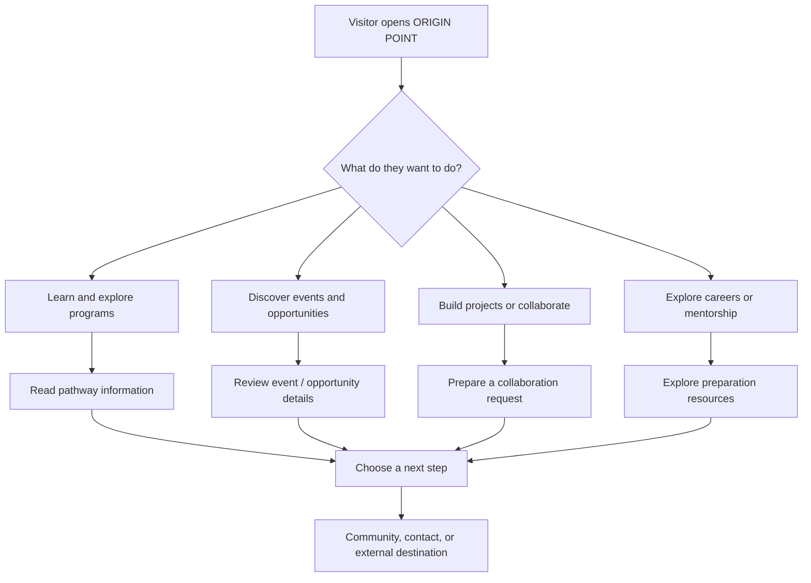
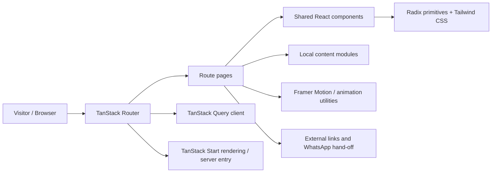
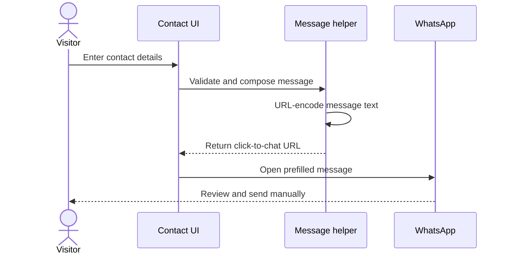
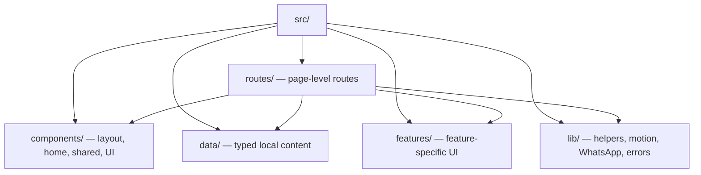

<div align="center">

# ORIGIN POINT

### Every Journey Has an Origin.

**A community-first digital ecosystem for people who want to learn, build, connect, and grow.**

[Explore](#-what-is-origin-point) · [Why I Built It](#-why-i-built-origin-point) · [Features](#-what-you-can-explore) · [Architecture](#-how-it-works) · [Tech Stack](#-technology-stack) · [Setup](#-run-it-locally) · [Connect](#-about-the-developer)

</div>

---

## ✦ What is ORIGIN POINT?

**ORIGIN POINT is a community and opportunity platform concept that brings learning, building projects, collaboration, career preparation, mentorship, and events into one discoverable place.** It is designed for students, developers, designers, creators, and early-stage founders who want a clearer path from curiosity to building real things.

Rather than presenting learning, projects, networking, and career preparation as unrelated destinations, ORIGIN POINT groups them into connected pathways. Visitors can explore programs, discover opportunities, understand how to participate, and continue through community or contact links.

> **In simple words:** ORIGIN POINT is a starting point for builders. It helps people discover what they can learn, what they can build, who they can connect with, and where they can go next.

> **Current implementation note:** The supplied repository is primarily a polished route-based web experience. A page describing a service does not automatically mean a full backend-powered service is live. The repository does not show a connected persistent database, authentication system, or full application API for these flows.

## 🎯 Why I built ORIGIN POINT

I built ORIGIN POINT to make it easier for people—especially students and early-stage builders—to find a starting point and move from learning to practical work. Useful resources and opportunities are often scattered across different websites, communities, event pages, and social platforms. That fragmentation can make it difficult to know what to do next or how to get involved.

The idea behind ORIGIN POINT is to bring those paths together in a single, clear experience:

- **Find your direction:** discover programs, learning pathways, events, and opportunities.
- **Move from learning to building:** explore projects and open-source contribution pathways.
- **Connect with people:** find routes for collaboration, mentorship, and community participation.
- **Prepare for what comes next:** explore career preparation and practical development opportunities.
- **Keep the experience approachable:** make the interface structured, responsive, and easy to navigate.

This is a step toward a more connected builder ecosystem—not a claim that every planned service is already fully automated or backed by a live database. The codebase is the foundation for evolving that vision over time.

## 🧭 The visitor journey



## ✨ What you can explore

| Area | Purpose |
|---|---|
| **Community** | Discover how to join and participate in the builder ecosystem. |
| **Programs** | Explore program families including OP Learn, OP Build, OP Hack, OP Careers, OP Connect, and OP Launch. |
| **Opportunities & Radar** | Browse opportunity/event information and follow relevant external links. |
| **Projects & Open Source** | Explore project ideas and a suggested build/contribution lifecycle. |
| **Collaborate** | Configure skills and collaboration preferences and prepare a message. |
| **Careers** | Explore preparation pathways, resume review, mock interviews, and skill-gap planning information. |
| **Community Compass** | Answer a short guided questionnaire to identify a useful starting point. |
| **Events & Spotlight** | Explore event information, member highlights, and build-log concepts. |
| **Mentorship & Campus Ambassador** | Read program information and routes for getting involved. |
| **Contact** | Prepare a message and open the configured WhatsApp/contact route. |
| **Trust & information** | Read FAQ, privacy, terms, about, and team pages. |
| **Motion-led interface** | Use responsive layouts, reveal effects, a custom cursor, and a pixel-style team visual. |

## 🧱 How it works

The application is organized around route pages, shared React components, local typed content, and helper utilities. A visitor navigates through the TanStack route system; pages compose reusable UI; styling and animation provide the visual layer; and selected actions hand off to external destinations such as WhatsApp.



### Main interaction: Contact / WhatsApp



The website prepares a click-to-chat link. It does **not** directly send a WhatsApp message on the visitor's behalf, and this flow does not imply that form details are persisted in an application database.

### Source-code map



## 🧰 Technology stack

| Layer | Technology | Role in this project |
|---|---|---|
| Language | **TypeScript** | Typed application code and clearer contracts. |
| UI library | **React 19** | Component-based interface and reusable UI. |
| Application framework | **TanStack Start** | Application/server rendering structure and framework integration. |
| Routing | **TanStack Router** | File-based routes and client-side navigation. |
| Build tooling | **Vite 8** | Development server and production build pipeline. |
| Styling | **Tailwind CSS 4** | Utility-first styling and responsive layouts. |
| UI primitives | **Radix UI + custom components** | Reusable interaction primitives and accessible UI foundations. |
| Animation | **Framer Motion, GSAP** | Motion and reveal effects; a dependency being installed does not prove every page uses it. |
| Icons | **Lucide React** | Consistent interface icons. |
| Server-state utilities | **TanStack Query** | Query-client infrastructure; not proof of a connected remote API. |
| Forms / validation | **React Hook Form, Zod, resolvers** | Form and validation tooling available in the codebase. |
| Charts | **Recharts** | Charting library available to the application. |
| Notifications | **Sonner** | Toast notification UI. |
| Testing | **Vitest, Testing Library, jsdom** | Test tooling configured in the project. |
| Code quality | **ESLint, Prettier** | Linting and formatting scripts. |
| Package management | **Bun lockfile** | Reproducible dependency installation with Bun; npm may also work. |
| Deployment integration | **Nitro / Vite configuration** | Deployment adapter configured in the supplied Vite setup; verify the target before deploying elsewhere. |

### Architecture boundaries

- **Content:** Much of the site's information is held in local TypeScript modules under `src/data/`.
- **UI:** Route components compose shared layout, home, shared, feature, and UI components.
- **Navigation:** TanStack Router manages the file-based route structure.
- **External actions:** Selected interactions open an external destination or prepare a message.
- **Persistence:** The supplied source does not establish a connected persistent database or full account-backed service.

## 🗺️ Application routes

The following route files are present in `src/routes/`:

| Route | Purpose |
|---|---|
| `/` | Homepage and ecosystem overview |
| `/about` | Mission and background |
| `/campus-ambassador` | Campus ambassador information |
| `/careers` | Career preparation pathways |
| `/collaborate` | Collaboration request builder |
| `/community` | Community introduction and joining route |
| `/compass` | Guided starting-point recommender |
| `/contact` | Contact options |
| `/events` | Events information |
| `/faq` | Frequently asked questions |
| `/guide` | Community / getting-started guide |
| `/join` | Participation information |
| `/mentorship` | Mentorship information |
| `/op-ai` | OP AI assistant page/widget entry point |
| `/opportunities` | Opportunity discovery overview |
| `/privacy` | Privacy information |
| `/programs` | Program families and status notes |
| `/projects` | Projects and open-source information |
| `/radar` | Event/opportunity radar |
| `/spotlight` | Member spotlight and build-log information |
| `/team` | Team / founders information |
| `/terms` | Terms of use |

Route availability describes the pages in the source tree, not necessarily a live API-backed service behind each page. The generated TanStack route tree should normally be managed by the framework tooling rather than edited manually.

## 📁 Project structure

```text
originpoint-main/
├── public/                  # Public static assets and robots.txt
├── src/
│   ├── assets/              # Images and project assets
│   ├── routes/              # File-based pages and route metadata
│   ├── components/
│   │   ├── home/            # Homepage sections
│   │   ├── layout/          # Header and footer
│   │   ├── shared/          # Reusable sections, cards, reveals, cursor
│   │   └── ui/              # UI primitives
│   ├── features/            # Feature-specific UI
│   ├── data/                # Local content and configuration
│   ├── lib/                 # Helpers, motion, WhatsApp and error handling
│   ├── styles.css           # Global styles / Tailwind entry
│   ├── router.tsx           # Router setup
│   ├── start.ts             # Start middleware configuration
│   └── server.ts            # Server entry and error normalization
├── package.json             # Scripts and dependencies
├── bun.lock                 # Bun dependency lockfile
├── vite.config.ts           # Vite / framework configuration
├── tsconfig.json            # TypeScript configuration
└── vitest.config.ts         # Test configuration
```

## 🚀 Run it locally

### Prerequisites

- A current Node.js version compatible with the installed Vite/tooling.
- **Bun recommended** because the repository includes `bun.lock`; npm can be tried as an alternative.
- Git, if cloning the repository.

### 1. Install dependencies

```bash
bun install
```

Alternative:

```bash
npm install
```

### 2. Start development server

```bash
bun run dev
```

Or:

```bash
npm run dev
```

Open the local URL printed in the terminal. Vite commonly uses `http://localhost:5173`, but use the actual URL and port shown in your terminal.

### 3. Build for production

```bash
bun run build
```

### 4. Run code-quality checks

Use the scripts defined in `package.json`; common project scripts include linting, formatting, and tests. Check the exact script names before running them:

```bash
cat package.json
```

Then run the appropriate commands, for example `bun run lint` or `bun run test`, only if those scripts are present. A successful local build and a successful deployment are separate checks.

## 🔌 What is and is not connected?

| Area | What the source indicates | Practical implication |
|---|---|---|
| Route pages | Present in `src/routes/` | Pages can render as part of the web experience. |
| Local content | Data modules are present | Content can be displayed without fetching it from a database. |
| WhatsApp contact | Click-to-chat helper/route | Visitor reviews and sends the message in WhatsApp. |
| Collaboration flow | Client-side request/message composition | Do not assume requests are stored or matched through a backend. |
| TanStack Start server entry | Present | Server/framework code exists, but that alone is not a database or application API. |
| TanStack Query | Configured dependency/client | A query library alone does not prove a live service is connected. |
| Database / persistent accounts | No connected database/auth system established by the supplied source | Do not advertise database persistence, login, or user accounts as live unless implemented separately. |
| OP AI route | Page/widget entry point exists | Verify provider/API integration and runtime behavior before describing it as a working AI service. |
| Tests and deployment | Tooling/configuration exists | Run the commands and validate the actual hosting target to confirm readiness. |

## 🔐 Security and privacy notes

- Never commit API keys, tokens, passwords, private credentials, or production secrets.
- If future features introduce accounts, submissions, analytics, or an AI API, define data retention, consent, validation, rate limits, and access control before launch.
- Treat client-side validation as a usability measure, not a security boundary.
- Review external links and contact destinations before production deployment.
- Ensure privacy and terms pages match the real data practices of the deployed product.

## 🛣️ Suggested next steps

1. **Validate the release:** install dependencies, run lint/tests where available, build production, and smoke-test all routes.
2. **Define the MVP:** decide which features should be informational and which require real submissions, accounts, or persistent data.
3. **Add backend only where needed:** choose a database/API and authentication design if the product requires persistent user workflows.
4. **Instrument responsibly:** add privacy-conscious analytics only if there is a clear product question to answer.
5. **Improve accessibility:** verify keyboard navigation, focus states, contrast, reduced-motion support, and screen-reader labels.
6. **Document deployment:** record the chosen host, build command, output/runtime expectations, environment variables, and rollback plan.

## 👨‍💻 About the developer

**ORIGIN POINT was developed by Vansh Raj Singh, professionally known as Vansh Rajput.** He is a developer and builder interested in web products, AI/ML, and creating practical digital experiences for learners and communities.

He built ORIGIN POINT around the idea that people should not have to piece together their next step from disconnected resources. The platform brings community discovery, learning pathways, projects, collaboration, opportunities, and career-oriented information into one navigable experience. The goal is to make it easier to discover a direction, take action, and keep building.

### Find me online

| Platform | Profile |
|---|---|
| **Portfolio** | [vanshrajput.in](https://vanshrajput.in) |
| **GitHub** | [@vanshrajputcodes](https://github.com/vanshrajputcodes) |
| **LinkedIn** | [linkedin.com/in/linkvansh](https://www.linkedin.com/in/linkvansh) |
| **Instagram** | [@ig_vanshsingh](https://www.instagram.com/ig_vanshsingh/) |
| **YouTube** | [@vanshrajputcodes](https://www.youtube.com/vanshrajputcodes) |
| **Hack The Future** | [hackthefuture.in](https://hackthefuture.in) · [hackthefuture.co.in](https://hackthefuture.co.in) |
| **Hack The Future subdomain** | [htf.vanshrajput.in](https://htf.vanshrajput.in) |

> Social profile URLs are based on the handles supplied by the developer. If a platform changes its handle or redirects its profile, update the link here.

## 🤝 Contributing

Contributions and constructive feedback are welcome. Before opening a pull request:

1. Explain the problem or improvement.
2. Keep changes focused and consistent with the existing component patterns.
3. Run relevant lint, test, and build checks available in `package.json`.
4. Include screenshots or a short recording for meaningful UI changes.
5. Do not include secrets, private data, or unrelated generated files.

## 📄 License

No license is specified in this README because a license should reflect the project owner's intended reuse terms. Add a `LICENSE` file before presenting the repository as open source, and choose a license deliberately.

---

<div align="center">

**ORIGIN POINT** · *Every Journey Has an Origin.*

Built by **Vansh Raj Singh (Vansh Rajput)**

[Portfolio](https://vanshrajput.in) · [GitHub](https://github.com/vanshrajputcodes) · [LinkedIn](https://www.linkedin.com/in/linkvansh) · [Instagram](https://www.instagram.com/ig_vanshsingh/) · [YouTube](https://www.youtube.com/vanshrajputcodes)

</div>


## About the Developer

**ORIGIN POINT was developed by Vansh Raj Singh, professionally known as Vansh Rajput** — a developer, AI product builder, and founder of Hack The Future.

I built ORIGIN POINT to give students, developers, designers, creators, and early-stage founders a clearer starting point to discover opportunities, build practical projects, find mentorship, and connect with a wider builder community. The long-term vision is to reduce the fragmentation between learning, projects, events, collaboration, and career growth by bringing these journeys together in one coherent digital experience.

### Connect with Vansh

- **Portfolio:** https://vanshrajput.in
- **GitHub:** https://github.com/vanshrajputcodes
- **LinkedIn:** https://www.linkedin.com/in/linkvansh/
- **Instagram:** https://www.instagram.com/ig_vanshsingh/
- **YouTube:** https://www.youtube.com/vanshrajputcodes

### Project

- **Repository:** https://github.com/vanshrajputcodes/originpoint
